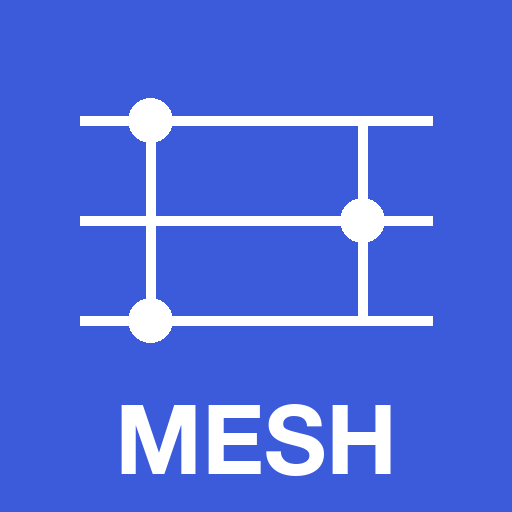

# Web del proyecto MESH




Sitio estático construido con [Astro](https://astro.build), con la misma hoja de estilos (convenciones al-folio: Roboto, un color de acento en `--global-theme-color`, barra y pie fijos, modo oscuro automático) que la web del proyecto APT-GRAN y la web personal del IP. Todo el contenido vive en `src/content/` como ficheros Markdown con cabecera YAML; no hace falta tocar código para añadir noticias, resultados, publicaciones, recursos o personas.

## Uso

```bash
npm install        # solo la primera vez
npm run dev        # servidor local en http://localhost:4321
npm run build      # genera el sitio en dist/
```

## Añadir contenido

| Qué | Carpeta | Plantilla |
|---|---|---|
| Noticia | `src/content/noticias/` y `noticias/en/` | ver `2026-10-concesion.md` (campos opcionales `url` y `etiqueta` para un enlace) |
| Resultado | `src/content/resultados/` y `resultados/en/` | `_ejemplo.md.txt` |
| Publicación | `src/content/publicaciones/` | `_ejemplo.md.txt` |
| Recurso (dataset, software, modelo) | `src/content/recursos/` | `_ejemplo.md.txt` |
| Persona | `src/content/equipo/` | cualquier fichero existente; `tipo` agrupa en equipo de investigación, equipo de trabajo, colaboradores o personal contratado |
| Tesis, TFM o TFG | se genera solo: entrada en resultados con `clase: tesis`, `tfm` o `tfg` | `_ejemplo.md.txt` |

Copia la plantilla, renómbrala a `<slug>.md`, rellena la cabecera y ejecuta `npm run build`. Si falta un campo obligatorio o un valor no es válido, la compilación falla indicando el fichero.

Los ficheros `_ejemplo.md.txt` no se publican.

## Idiomas

El español se sirve en la raíz y el inglés en `/en/`. Cada página tiene su equivalente en `src/pages/en/` y la navegación incluye el cambio de idioma. Los textos de interfaz (menú, rótulos, avisos) están en `src/i18n.ts`.

- **Noticias y resultados**: un fichero por idioma. Los ingleses van en la subcarpeta `en/` de la colección, con el mismo nombre de fichero que el español.
- **Publicaciones, recursos y equipo**: un solo fichero para ambos idiomas, con campos opcionales `titulo_en`, `venue_en`, `resumen_en` y `rol_en`. Si faltan, se muestra el texto en español.

## Páginas

- `src/pages/index.astro`: portada con presentación y últimas noticias. Los listados viven en `src/components/` y se reutilizan en ambos idiomas.
- `src/pages/proyecto.astro`: por qué, hipótesis, objetivos, casos de uso, ciencia abierta, impacto, financiación, cita y transferencia. Texto fijo; las figuras están en `public/img/`.
- `src/pages/resultados.astro`: lista cronológica de resultados con etiqueta temática, y tesis o trabajos académicos.
- `src/pages/publicaciones.astro`: agrupadas por tipo.
- `src/pages/recursos.astro`: tarjetas con enlaces a GitHub, Zenodo y Hugging Face.
- `src/pages/equipo.astro`: fichas agrupadas por tipo, colaboraciones y contacto.

## Pendiente antes de publicar

- Enlace real a Hugging Face en `src/components/Social.astro` (Zenodo ya apunta a la comunidad `mesh-uah`) y, si se crean cuentas en redes, añadirlas ahí.
- Crear el sitio `mesh-uah` en GoatCounter (o cambiar `goatcounter` en `src/i18n.ts`).

El logotipo `public/img/aei.png` es el oficial MICIU+AEI que la AEI indica para los Proyectos de Generación de Conocimiento 2025 (sin cofinanciación FEDER), tomado de su guía de obligaciones de publicidad.

## Despliegue en GitHub Pages

El repositorio es https://github.com/GNOSIS-UAH/mesh. Cada push a `main` ejecuta `.github/workflows/deploy.yml` y publica el sitio en https://gnosis-uah.github.io/mesh/. Si se cambia el repositorio o el dominio, ajustar `site` y `base` en `astro.config.mjs`.
